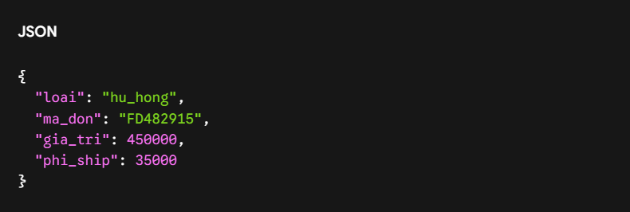
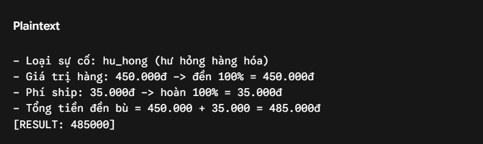
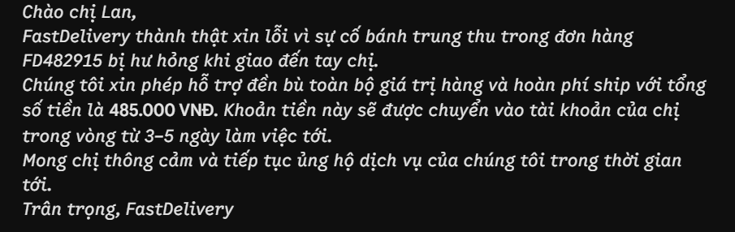

## Báo cáo thiết kế

 Khách gửi thư khiếu nại. Hệ thống phải tự đọc thư, tính tiền đền bù và soạn email trả lời, mà không được sai tiền và không được “đứng hình” khi gặp thư lạ.

 **Cách giải:** Chia thành 3 trạm. Kết quả trạm trước là đầu vào của trạm sau, giữa các trạm có chốt kiểm tra.

```
Thư khách
   ↓
[Trạm 1: Đọc thư] → JSON ──► Chốt 1 (đủ thông tin? mã đơn đúng?)
                                  ↓ ok                 ✗ → chuyển nhân viên
[Trạm 2: Tính tiền] → số tiền ──► Chốt 2 (code tính lại có khớp? dưới 10 triệu?)
                                  ↓ ok                 ✗ → chuyển nhân viên / chờ duyệt
[Trạm 3: Viết email] → email hoàn chỉnh
```

**Vận dụng kiến thức đã học**:
**Prompt Chaining:** Chia 3 trạm, mỗi trạm làm 1 việc, truyền dữ liệu bằng JSON sạch

**Chain-of-Thought**: Trạm 2 suy nghĩ từng bước khi tính tiền
**Xử lý đứt gãy**	Trạm 3 email bị cắt giữa chừng thì mớm 5 từ cuối để viết tiếp
**Neo** vai trò	Đầu prompt mỗi trạm nhắc lại vai trò

## Viết Promp

**Trạm 1: Đọc thư** 
```
Bạn là nhân viên phân loại thư khiếu nại của FastDelivery.
Chỉ trả về JSON, không viết thêm chữ nào khác:
{"loai": "hu_hong" | "cham" | "that_lac",
 "ma_don": "FD + 6 số", "gia_tri": số đồng, "phi_ship": số đồng}
Thiếu thông tin thì ghi null. Không được đoán.

THƯ: {{NOI_DUNG_THU}}
```

**Trạm 2: Tính tiền** 
```
Bạn là kế toán FastDelivery. Chính sách:
- hu_hong: đền 100% giá trị hàng + hoàn phí ship
- cham: hoàn 50% phí ship
- that_lac: đền 100% giá trị hàng
Hãy suy nghĩ từng bước (tối đa 4 dòng), rồi ghi kết quả
ở dòng cuối đúng dạng: [RESULT: số tiền]

DỮ LIỆU: {{JSON_TU_TRAM_1}}
```

**Trạm 3: Viết email** 
```
[Vai trò] Bạn là nhân viên CSKH FastDelivery, giọng lịch sự, chân thành.
Viết email tối đa 120 từ gồm: lời xin lỗi, mã đơn, số tiền đền bù,
thời gian nhận tiền (3-5 ngày làm việc).
Chỉ dùng thông tin được cung cấp. Kết thúc bằng: "Trân trọng, FastDelivery"

THÔNG TIN: Loại: {{LOAI}}; Mã đơn: {{MA_DON}}; Tiền đền: {{SO_TIEN}} đồng
```

## Kết quả

**Thư đầu vào**:  “Chào shop, đơn FD482915 của mình đặt 2 hộp bánh trung thu, mở ra thấy bị nát hết. Giá hàng 450.000đ, phí ship 35.000đ. Mong shop xử lý sớm. – Lan”

**Trạm 1**:



**Trạm 2**: 



**Trạm 3**:

